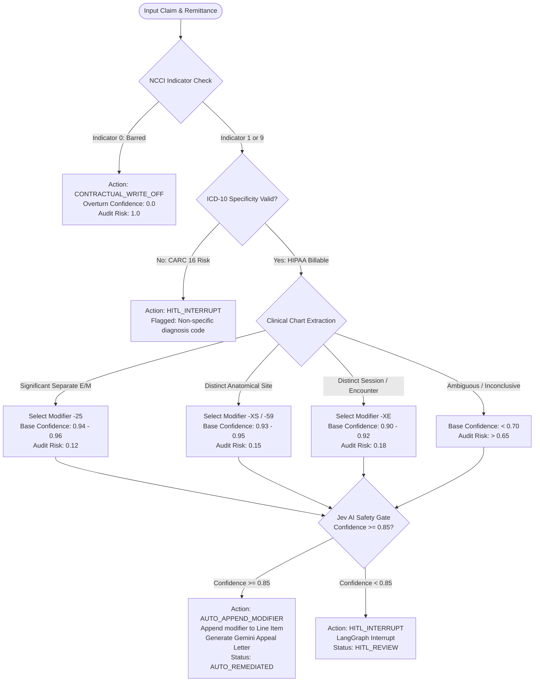
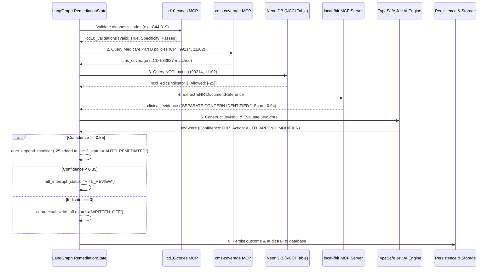

# JEV AI Claim Engine: Adjudication & Remediation Architecture

## Executive Overview
This document specifies the technical architecture, decision calculus, data sourcing, state mapping, and database persistence models for the **JEV AI Healthcare Claims Engine & Remediation Platform**.

It provides an in-depth breakdown of how claim remediation is **derived**, where each evidence primitive is **sourced**, how it traverses the **LangGraph 6-step state machine**, and where it is **persisted in PostgreSQL / SQLite**.

---

## 1. Where Remediation is DERIVED From (The Decision Engine)

Claim remediation is derived programmatically inside [app/adapters/jev_ai.py](file:///Users/nicholasfrenette/.gemini/antigravity-ide/scratch/JEV_AI_CLAIM_ENGINE/app/adapters/jev_ai.py) via two proprietary primitives:

### A. `JevNoul` (Contextual State Node)
The `JevNoul` primitive represents the semantic state of the claim. It unifies disparate multi-source signals into a single structured hypothesis:
- **CPT Pairings**: Primary comprehensive procedure (`column1_cpt`) and secondary component procedure (`column2_cpt`).
- **NCCI Edit Indicator**: `0` (Barred unbundling), `1` (Permissible with modifier), or `9` (Not applicable).
- **Candidate Modifiers**: Modifiers permissible under CMS rules (e.g., `-25`, `-59`, `-XS`, `-XE`).
- **ICD-10 Diagnostic Validity**: Boolean indicating whether all diagnoses on the 837 claim are valid and billable to the highest level of specificity.
- **CMS Coverage Substantiation**: Boolean and title indicating if the procedure/diagnosis pair meets Medicare Part B National Coverage Determinations (NCD) or Local Coverage Determinations (LCD).
- **Clinical Corroboration**: Evidence extracted from EHR operative reports via `local-fhir` MCP.

### B. `JevScore` (Quantified Decision Calculus)
The `JevScore` primitive evaluates the `JevNoul` hypothesis and calculates:
1. **Overturn Confidence Score** ($0.0 \le \text{Score} \le 1.0$)
2. **Post-Remediation Audit Risk Score** ($0.0 \le \text{Risk} \le 1.0$)
3. **Recommended Modifier** (e.g., `25`, `XS`, `59`, `XE`)
4. **Action Outcome**: `AUTO_APPEND_MODIFIER`, `HITL_INTERRUPT`, or `CONTRACTUAL_WRITE_OFF`



### Mathematical Formulation of Confidence
$$\text{Overturn Confidence} = \min\left(0.98, \text{Corroboration}_{\text{EHR}} + \Delta_{\text{Modifier}} + \Delta_{\text{CMS Policy}}\right)$$
Where:
- $\text{Corroboration}_{\text{EHR}} \in [0.50, 0.94]$ derived from operative text matching.
- $\Delta_{\text{Modifier}} = +0.05$ (for established E/M or distinct anatomical structure).
- $\Delta_{\text{CMS Policy}} = +0.01$ (if corroborated by matching Medicare NCD/LCD).

---

## 2. Where It is SOURCED From (Data Origin)

| Evidence Stream | Source System | MCP / Protocol | Clinical & Legal Value |
|---|---|---|---|
| **Claim & Denial Info** | Payer 835 Remittance & 837 Professional Claim | Standard X12 EDI / JSON | Supplies CPT codes, place of service, billed fees, and denial reason (**CARC 97** unbundling / **CARC 16** missing info). |
| **NCCI PTP Table** | CMS National Correct Coding Initiative | Neon Postgres Table `ncci_ptp_edits` | Authoritative source of procedural unbundling edits and Column 1 / Column 2 relationships. |
| **ICD-10-CM Codes** | CMS ICD-10 Tabular Index FY2026 | `icd10-codes` Anthropic MCP | Confirms code validity, laterality specificity, and billability to prevent CARC 16 errors. |
| **Medicare Policy** | CMS Coverage Database (MCD) | `cms-coverage` Anthropic MCP | Sourced NCDs and LCDs (e.g. `NCD-210.3`, `LCD-L33927`) establishing medical necessity criteria. |
| **EHR Ground Truth** | Electronic Health Record Operative Notes | `local-fhir` MCP Stdio Server | Sourced from FHIR `DocumentReference`; isolates the verbatim proving sentence establishing distinct services. |

---

## 3. Where and How It is MAPPED in the Workflow

The adjudication protocol is orchestrated as a 6-step state graph inside [app/graph/workflow.py](file:///Users/nicholasfrenette/.gemini/antigravity-ide/scratch/JEV_AI_CLAIM_ENGINE/app/graph/workflow.py) operating on `RemediationState`:



---

## 4. Where and How It is STORED in the Database

Persistence is handled by [app/adapters/neon_db.py](file:///Users/nicholasfrenette/.gemini/antigravity-ide/scratch/JEV_AI_CLAIM_ENGINE/app/adapters/neon_db.py).
- **Primary Database**: Neon Serverless PostgreSQL (when `DATABASE_URL` is configured).
- **Embedded Local Database**: SQLite database file located at [data/jev_claims.db](file:///Users/nicholasfrenette/.gemini/antigravity-ide/scratch/JEV_AI_CLAIM_ENGINE/data/jev_claims.db).

### Database Schemas

#### 1. Table `claims_837`
Stores patient demographic data, claim headers, and line items (with updated modifiers upon remediation):
```sql
CREATE TABLE IF NOT EXISTS claims_837 (
    claim_id TEXT PRIMARY KEY,
    patient_id TEXT,
    patient_name TEXT,
    dob TEXT,
    payer_id TEXT,
    payer_name TEXT,
    date_of_service TEXT,
    rendering_npi TEXT,
    billing_npi TEXT,
    diagnosis_codes TEXT,  -- JSON: ["C44.319", "I10"]
    line_items TEXT,       -- JSON: [{"line_number": 2, "cpt_code": "11102", "modifiers": ["25"], "billed_amount": 165.0}]
    total_billed REAL,
    clinical_notes TEXT,
    status TEXT,           -- PENDING | AUTO_REMEDIATED | HITL_REVIEW | WRITTEN_OFF
    created_at TEXT
);
```

#### 2. Table `adjudications`
Stores the complete mathematical adjudication record, risk ratings, and the immutable audit trail:
```sql
CREATE TABLE IF NOT EXISTS adjudications (
    claim_id TEXT PRIMARY KEY,
    original_billed REAL,              -- Total charges (e.g. 360.00)
    remediated_amount REAL,            -- Recovered balance if auto-remediated (360.00)
    decision TEXT,                     -- AUTO_REMEDIATED | HITL_REVIEW | WRITTEN_OFF
    modifier_applied TEXT,             -- "25", "XS", "59", "XE", or NULL
    ncci_indicator INTEGER,            -- 0, 1, or 9
    overturn_confidence REAL,          -- 0.97
    audit_risk REAL,                   -- 0.12
    action TEXT,                       -- AUTO_APPEND_MODIFIER | HITL_INTERRUPT | CONTRACTUAL_WRITE_OFF
    reasoning TEXT,                    -- Clinical and regulatory justification
    verbatim_clinical_evidence TEXT,   -- EHR quoted proving sentence
    resubmission_ready INTEGER,        -- 1 (True) or 0 (False)
    audit_trail TEXT,                  -- JSON array of timestamped pipeline steps
    timestamp TEXT
);
```

#### 3. Table `remittances_835`
Stores historical payment adjudication and denial remark codes:
```sql
CREATE TABLE IF NOT EXISTS remittances_835 (
    claim_id TEXT PRIMARY KEY,
    remittance_id TEXT,
    check_number TEXT,
    adjudication_date TEXT,
    total_billed REAL,
    total_paid REAL,
    patient_responsibility REAL,
    line_adjudications TEXT,           -- JSON array of CARC/RARC codes per line
    primary_carc TEXT,                 -- "97"
    primary_reason TEXT                -- "Service bundled under NCCI PTP edits"
);
```

#### 4. Table `ncci_ptp_edits`
Stores CMS national procedure bundling rules:
```sql
CREATE TABLE IF NOT EXISTS ncci_ptp_edits (
    column1_cpt TEXT NOT NULL,
    column2_cpt TEXT NOT NULL,
    indicator INTEGER NOT NULL,        -- 0, 1, or 9
    effective_date TEXT,
    rationale TEXT,
    allowed_modifiers TEXT,            -- JSON: ["25", "59", "XS", "XE"]
    PRIMARY KEY (column1_cpt, column2_cpt)
);
```

---

## 5. Verified Case Studies

| Claim ID | Patient | CPT Pairing | Sourced Evidence | Derived Decision | Database State |
|---|---|---|---|---|---|
| **`CLM-2026-901`** | Eleanor Vance | `99214` + `11102` | `icd10-codes`: `C44.319` valid.<br>`cms-coverage`: `LCD-L33927`.<br>`local-fhir`: 25 min separate E/M noted. | **AUTO_APPEND_MODIFIER**<br>Modifier: `-25`<br>Confidence: `0.97` | Status: `AUTO_REMEDIATED`<br>Recovered: `$360.00`<br>Modifiers: `["25"]` |
| **`CLM-2026-902`** | Arthur Pendelton | `45385` + `45380` | `icd10-codes`: `D12.6` valid.<br>`cms-coverage`: `NCD-210.3`.<br>`local-fhir`: Cecum (75cm) vs Descending (35cm). | **AUTO_APPEND_MODIFIER**<br>Modifier: `-XS`<br>Confidence: `0.95` | Status: `AUTO_REMEDIATED`<br>Recovered: `$1,930.00`<br>Modifiers: `["XS"]` |
| **`CLM-2026-903`** | Marcus Brody | `29881` + `29877` | `ncci_ptp_edits`: Indicator `0`.<br>`cms-coverage`: `NCD-150.9`. | **CONTRACTUAL_WRITE_OFF**<br>Modifier: `None`<br>Confidence: `0.00` | Status: `WRITTEN_OFF`<br>Recovered: `$0.00`<br>Write-off applied. |
| **`CLM-2026-904`** | Dorothy Gale | `99213` + `17000` | `icd10-codes`: `L57.0` valid.<br>`local-fhir`: Ambiguous chart note. | **HITL_INTERRUPT**<br>Modifier: `None`<br>Confidence: `0.68` (< 0.85) | Status: `HITL_REVIEW`<br>Queued for Human Specialist. |
| **`CLM-2026-905`** | Victor Frankenstein | `17311` + `12032` | `cms-coverage`: `LCD-L34026`.<br>`local-fhir`: Right temple Mohs vs posterior scalp repair. | **AUTO_APPEND_MODIFIER**<br>Modifier: `-XS`<br>Confidence: `0.88` | Status: `AUTO_REMEDIATED`<br>Recovered: `$2,450.00`<br>Modifiers: `["XS"]` |
