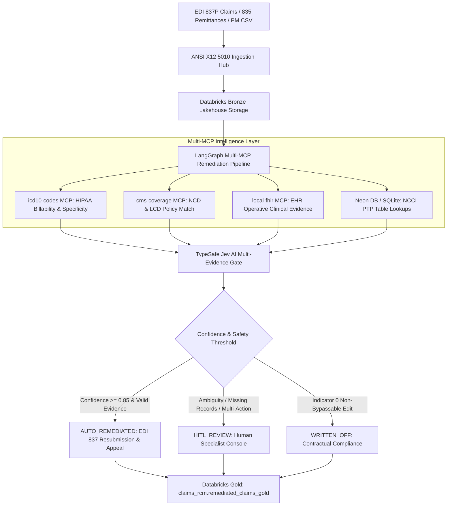

# Jev AI Claim Engine (`Jev_AI_Claim_Engine`)

> **Autonomous Healthcare Revenue Cycle Management (RCM) & Denial Remediation Platform**  
> Powered by LangGraph, TypeSafe Jev AI Decision Engine, Anthropic Multi-MCP tools, and Databricks Lakehouse.

---

## 🌟 Overview

The **Jev AI Claim Engine** is an enterprise-grade autonomous claims remediation platform designed to eliminate healthcare denial write-offs, prevent audit clawbacks, and automate electronic resubmission.

By fusing clinical ground truth with statutory payer regulations, the platform evaluates each claim line item across multi-dimensional criteria:
$$\text{Payer Category} \times \text{Plan Type} \times \text{CARC Code} \times \text{RARC Code} \times \text{NCCI PTP Indicator}$$

The engine autonomously identifies root causes, verifies diagnostic specificity and medical necessity, packages certified electronic evidence, and executes tailored remediation strategies.

---

## 🔬 Multi-MCP Architectural Pattern

The platform incorporates patterns from leading open-source healthcare repositories:
- **`microsoft/RHAIL-Claims-Denial-Navigator`**: Remittance multi-field parsing and CAQH CORE Phase III Rule 360 scenario categorization.
- **`sarvanithin/ClaimPilot`**: Payer policy RAG and LCD/NCD citation-backed formal appeal packet generation.
- **`aws-samples/sample-healthcare-agents`**: Multi-tier denial rule lookup (`search_denial_rules`) with mandatory clinical evidence packaging.
- **`Kustode-ce/medical-billing-mcp`**: ANSI ASC X12 standard dictionary and compliant modifier determination (`-25`, `-59`, `-XS`, `-XE`).



---

## 🚀 Key Features

1. **Granular Service Line Item Adjudication**:
   - Captures and displays Denial Reasons (CARC and RARC) at both the claim header and individual **service line item (835 SVC / CAS loops)** level.
   - Formatted charges with clean thousands separators (`$895,700`, `$91,294`) and full allowance/payment tracking.

2. **Multi-Payer Denial Matrix**:
   - Tailored remediation protocols for Traditional Medicare (Part B), Medicare Advantage, Commercial PPO/HMO, Managed Medicaid, Workers' Comp, and Auto PIP/No-Fault.
   - Comprehensive crosswalk covering CARC 29, 16, 50, 197, 4, 97, 22, 18, 45, 96, 236 with standard RARCs.

3. **Dynamic Specialist Console (HITL)**:
   - Dynamic, context-sensitive action buttons generated per denial scenario (e.g. *Attach 277CA Timely Filing Proof*, *Attach Signed Operative Note*, *Initiate Retroactive Prior Auth*, *Append Modifier -59*, or *Confirm Write-off*).
   - Full 6-tab inspection drawer (EDI 837/835, ICD-10 MCP, CMS Coverage MCP, Local FHIR MCP, TypeSafe Jev AI, and Appeal Letter).

4. **Lakehouse Synchronization**:
   - Ingestion hub supporting drag-and-drop 837P, 835, and Practice Management CSV reports.
   - Real-time synchronization to Databricks Unity Catalog (`claims_rcm.remediated_claims_gold`).

5. **Anthropic MCP Diagnostic Sandbox**:
   - Interactive live verification sandbox for NCCI PTP edits, ICD-10 diagnosis specificity, CMS LCD/NCD coverage policies, and CARC/RARC action pathways.

---

## 🛠️ Project Structure

```
Jev_AI_Claim_Engine/
├── app/
│   ├── adapters/
│   │   ├── databricks_adapter.py    # Databricks Lakehouse & Unity Catalog integration
│   │   ├── gemini_adapter.py        # Generative appeal letter drafting
│   │   ├── jev_ai.py                # TypeSafe Jev AI confidence & scoring engine
│   │   ├── mcp_tools.py             # Multi-MCP client wrappers (ICD-10, CMS, FHIR)
│   │   └── neon_db.py               # Database persistence adapter (Neon / SQLite)
│   ├── graph/
│   │   ├── state.py                 # LangGraph TypedDict pipeline state
│   │   └── workflow.py              # 6-step multi-MCP LangGraph DAG
│   ├── services/
│   │   ├── denial_knowledge_base.py # Payer normalization & multi-tier CARC rule engine
│   │   ├── edi_parser.py            # ANSI ASC X12 5010 & PM CSV parser
│   │   └── ingestion_service.py     # Automated batch file ingestion hub
│   ├── static/
│   │   ├── css/style.css            # Dark mode glassmorphism UI tokens
│   │   └── js/app.js                # Frontend reactive application logic
│   ├── templates/
│   │   └── index.html               # Main dashboard & deep inspection console
│   ├── main.py                      # FastAPI application & REST endpoints
│   └── models.py                    # Pydantic domain models
├── data/
│   ├── carc_rarc_crosswalk.json     # Payer/CARC/RARC crosswalk & action rules
│   ├── jev_claims.db                # SQLite database with 411 pre-loaded claims
│   ├── sample_edi/                  # Test 837P and 835 EDI transactions
│   └── seed_data.py                 # NCCI and claims database seeder
├── docs/                            # Architecture and plan documentation
├── servers/                         # MCP stdio server connectors
├── tests/                           # Pipeline & adapter test suites
├── requirements.txt                 # Project dependencies
├── .env.example                     # Environment template
└── README.md                        # Documentation
```

---

## 💻 Quick Start

### 1. Prerequisites
- Python 3.9+
- Git

### 2. Installation
```bash
# Clone the repository
git clone https://github.com/YOUR_ACCOUNT/Jev_AI_Claim_Engine.git
cd Jev_AI_Claim_Engine

# Create and activate virtual environment
python3 -m venv .venv
source .venv/bin/activate

# Install dependencies
pip install -r requirements.txt
```

### 3. Environment Configuration
```bash
cp .env.example .env
# Edit .env with your optional API keys (Gemini, Databricks, Neon)
```

### 4. Run Application Server
```bash
uvicorn app.main:app --host 127.0.0.1 --port 8000 --reload
```

Open your browser to: **`http://127.0.0.1:8000`**

---

## 📡 API Endpoints

| Method | Endpoint | Description |
| :--- | :--- | :--- |
| `GET` | `/api/metrics` | Real-time recovery KPIs and claim counts |
| `GET` | `/api/claims` | List all claims with line adjudications |
| `GET` | `/api/claims/{id}` | Deep inspection payload with multi-MCP evidence |
| `POST` | `/api/remediate/{id}` | Run 6-step multi-MCP LangGraph pipeline on claim |
| `POST` | `/api/remediate-all` | Batch reprocess claims through Jev AI engine |
| `POST` | `/api/human-decision` | Record specialist action and overturn |
| `GET` | `/api/denial-rules` | Retrieve full Payer / CARC / RARC crosswalk |
| `GET` | `/api/denial-lookup` | Query denial pathway for specific Payer + CARC + RARC |
| `POST` | `/api/ingest/upload` | Upload 837P, 835, or PM CSV files |
| `POST` | `/api/ingest/bulk` | Bulk ingest from data/ingest directory |
| `POST` | `/api/sync/databricks` | Synchronize remediated claims to Databricks Lakehouse |

---

## 📄 License
MIT License. Commercial and educational healthcare RCM use permitted.
